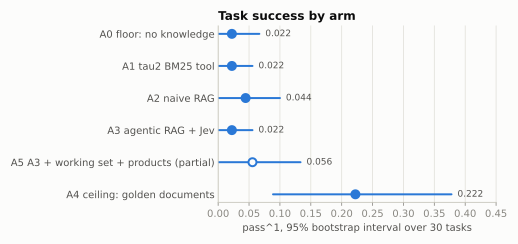
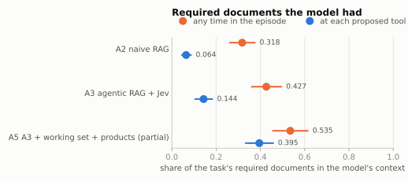
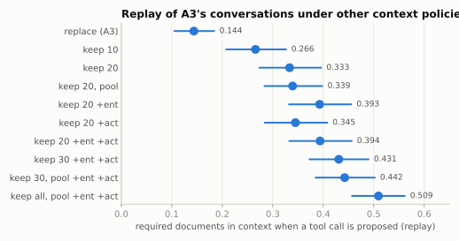
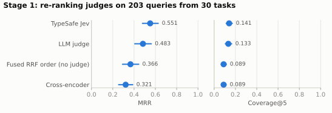
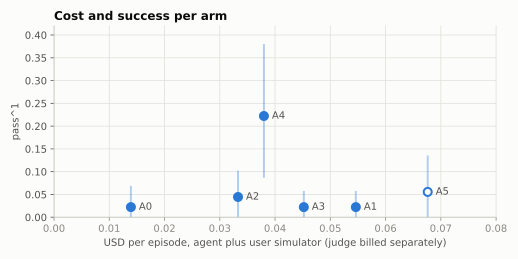

# policygate-rag

How much of an agent's task failure on τ²-bench's `banking_knowledge` domain is a
retrieval problem, and how much of it does agentic retrieval recover, at what cost?

One model, one user simulator, one harness ([policygate](https://github.com/Jackson117/PolicyGate), on in every
arm); only retrieval varies. Retrieval is hand-written (BM25, dense, reciprocal rank
fusion), the per-turn agent is a LangGraph graph, and every number below carries a 95%
bootstrap interval over tasks.

**Finding.** Perfect documents are worth **+0.200 [+0.056, +0.367]** pass^1 over no
documents, so retrieval is a real bottleneck. None of the retrieval pipelines recovers a
measurable part of it, including agentic RAG with the judge that won an offline
benchmark. The diagnosis: the model rarely has the required documents in context *when it
acts*. Fixing that (A5) lifts coverage at action time from 0.144 to 0.395, and task
success does not detectably follow. Even with every required document in the prompt, the
model fails 78% of attempts: most of this domain's failure is not retrieval.



## Design

tau2 ships both bounds, so the decomposition is measurable:

```
no_knowledge  <=  tau2 bm25  <=?  naive RAG  <=?  agentic RAG  <=  golden_retrieval
   floor          baseline        ours            ours              ceiling
```

| Arm | Retrieval | tau2 variant |
|---|---|---|
| A0 floor | none | `no_knowledge` |
| A1 external baseline | tau2's own BM25 search tool, called by the model | `bm25` |
| A2 naive RAG | hybrid BM25 + dense, the customer's message verbatim, top 5 per user turn | `no_knowledge` |
| A3 agentic RAG | wide retrieval → Jev judge → sufficiency check → rewrite, up to 3 rounds | `no_knowledge` |
| A5 A3 + working set | A3, with 20 documents kept across turns and lookup of products the conversation names | `no_knowledge` |
| A4 ceiling | the task's required documents in the prompt | `golden_retrieval` |

Held fixed in every arm:

- **Model:** `gpt-4.1-mini` for the agent and the user simulator, temperature 0. Chosen by
  a rule fixed before calibration: calibration measured USD 0.039 per episode averaged
  over arms, under the 0.056 the budget allows.
- **Harness:** policygate 0.3.0 with gating, audit and the loop guard. This is *not*
  policygate's `HarnessConfig.full()`: parallel-call blocking is a retail rule, and
  banking states nothing for validation or the approval gate to check.
- **Tasks:** a stratified, seeded 30-task subset (by number of required documents) of the
  87 tasks scored by world-state hash alone, × 3 trials, `max_steps` 100.
- **Labels:** each task's `required_documents` is read only in `eval/`; a test enforces it.

## Results

| Arm | pass^1 | pass^3 | USD / episode |
|---|---|---|---|
| A0 floor | 0.022 [0.000, 0.067] | 0.000 | 0.014 |
| A1 tau2 BM25 tool | 0.022 [0.000, 0.056] | 0.000 | 0.055 |
| A2 naive RAG | 0.044 [0.000, 0.100] | 0.000 | 0.033 |
| A3 agentic RAG + Jev | 0.022 [0.000, 0.056] | 0.000 | 0.045 + Jev 0.008 |
| A5 A3 + working set (partial, see below) | 0.056 [0.000, 0.133] | – | 0.068 + Jev 0.008 |
| A4 ceiling | 0.222 [0.089, 0.378] | 0.200 [0.067, 0.367] | 0.038 |

| Paired difference in pass^1 | Estimate |
|---|---|
| A4 − A0: what perfect documents are worth | +0.200 [+0.056, +0.367] |
| A1 − A0, A2 − A0, A3 − A0, A5 − A0 | +0.000, +0.022, +0.000, +0.033 (every interval includes 0) |
| A4 − A2: failure attributable to retrieval, after the best complete arm | +0.178 [+0.056, +0.322] |
| A5 − A3: what the working set adds | +0.033 [−0.011, +0.100] |
| 1 − A4: failure that remains with perfect documents | 0.778 |

A5 is partial: the budget guard stopped it at 72 of 90 episodes (every task has trial 1;
21 have all three). pass^1 is the per-task mean of the trials run, which is unbiased;
pass^3 is not reported. Trials 2–3 ran as a second batch with seed 301.

### Retrieval: what reached the model



| | A1 tau2 BM25 | A2 naive | A3 agentic | A5 working set |
|---|---|---|---|---|
| Coverage over the episode | 0.329 [0.262, 0.398] | 0.318 [0.262, 0.375] | 0.427 [0.361, 0.495] | 0.535 [0.456, 0.614] |
| Coverage at each proposed tool call | – | 0.064 [0.045, 0.087] | 0.144 [0.105, 0.183] | 0.395 [0.333, 0.458] |
| Precision of documents shown | 0.181 [0.142, 0.227] | 0.122 [0.098, 0.146] | 0.207 [0.168, 0.247] | 0.222 [0.183, 0.261] |

Coverage is the share of a task's required documents (median 10) in the model's context.
Over the episode it is the union of everything shown; at a tool call it is what the model
had at that moment, which is what can change what it does. A1's documents are read from
its search results; it has no per-step context to measure.

### Why agentic retrieval did not help

Tracing A3's required documents ([docs/replay_a3.md](docs/replay_a3.md)): 35% never reach
the top 20 of any query, 18% are rejected by the judge, 10% are cut by the top-5 limit.
The sufficiency check declares the documents sufficient on 91% of turns, most after one
round. Queries are the customer's words, so product documents (a referral comparing ten
accounts, a wallet holding three cards) and the procedure documents for the agent's next
action are hard to reach. And at most 5 documents are in the prompt at once, replaced on
every user turn.

An offline replay of A3's 90 recorded conversations, with no model calls, measured what
other context policies would have put in front of the model:



Keeping 20 documents across turns adds +0.190 [+0.152, +0.228] coverage at action time;
product lookup a further +0.060 [+0.026, +0.099]; a trigger on the agent's tool calls only
+0.012, because the agent only calls tools it has already read about. A5 runs the first
two live, and its measured coverage at action time, 0.395, matches the replay's 0.393.
Task success does not detectably follow, which is consistent with A4: complete documents
lift pass^1 only to 0.22.

### Stage 1: choosing the judge

Before stage 2, four judges re-ranked the same top-20 candidates for 203 queries harvested
from A2's episodes in 30 tasks. The LLM judge scored a per-task sample, and all four are
compared on the queries it scored.



| Judge | MRR | Coverage@5 | Cost |
|---|---|---|---|
| TypeSafe Jev (`jev-1.13.0`) | 0.551 [0.479, 0.627] | 0.141 [0.113, 0.170] | USD 0.43, own account |
| LLM judge (`gpt-4.1-mini`, batched) | 0.483 [0.406, 0.562] | 0.133 [0.105, 0.165] | USD 0.54 for a quarter of the pairs |
| Fused RRF order, no judge | 0.366 [0.292, 0.444] | 0.089 [0.066, 0.114] | – |
| Cross-encoder (`ms-marco-MiniLM-L6-v2`) | 0.321 [0.255, 0.387] | 0.089 [0.067, 0.112] | local |

Jev − LLM judge: MRR +0.068 [+0.022, +0.115]. The general-purpose cross-encoder does not
beat the fused order on this corpus (MRR −0.045 [−0.107, +0.011]). Details:
[docs/stage1_judges.md](docs/stage1_judges.md).

### Cost



Model spend: USD 28.88 of a 33.80 ceiling (27.89 on stage 2, after transfers from unused
lines), recorded per episode in `runs/ledger.json`; the 3.80 reserve was not touched. Jev
was billed to its own account: USD 1.74 in all. The ledger was last reconciled against
the provider's dashboard at USD 6.29.

## In the dashboard

[policygate](https://github.com/Jackson117/PolicyGate)'s Streamlit dashboard reads this repo's committed
`results/` directly, so the study's numbers are inspectable next to the harness
results they were produced with — and the retrieval step itself can be run
against a question you type.


*The same decomposition as above, read from `results/` at the commit named in
the sidebar. A5 is drawn hollow because it is partial — 72 of 90 episodes — so
pass^k for k > 1 is withheld rather than estimated from the trials that ran.*


*Retrieval for one question, the way arm A2 runs it. Each kept document shows
where each index ranked it, so disagreement between BM25 and the dense index is
visible rather than hidden inside the fused score: here 30 candidates fused, 10
of them found by both. The corpus embeddings are the study's cache; only the
query is embedded, and the page reports what that cost rather than assuming it.*

## Limits

- 30 tasks: pass^1 differences under about 0.15 cannot be resolved, and every retrieval
  arm sits near the floor, so they are not separated from each other.
- One model. A stronger model might use the same documents better; the ceiling says this
  one fails 78% of attempts even with them.
- Prompts differ by arm: A0, A1 and A4 use tau2's per-variant templates; A2, A3 and A5
  use `no_knowledge`'s plus a block of retrieved documents.
- The harness knows a verification was logged, not that the customer passed the bank's
  2-of-4 identity check.
- Coverage of the whole required set is a proxy: task_024 passed at 0.33 coverage, and
  A3 episodes that were shown every required document still failed.
- Three batches stalled on leaked HTTP connections in tau2's 10-connection client pool;
  stalled episodes were re-run from the start with the same seed and their partial spend
  booked. The cause of the leak is not found.

## Reproducing

```bash
uv sync                                               # Python 3.12-3.13
uv run pytest                                         # no network, no spend
uv run python -m policygate_rag.eval.export_results   # results/*.json from runs/
uv run python scripts/figures.py                      # docs/figures/*.svg from results/
```

Episodes cost money and need `OPENAI_API_KEY` (and `JEV_API_KEY` for A3 and A5). Every
batch goes through the budget guard, which refuses to start, or to continue, when the
projected spend exceeds its budget line:

```bash
uv run python -m policygate_rag.supervise --log runs/a3.log -- \
    --out runs/a3 --line stage2 --arms A3 --tasks subset --trials 3 \
    --prior 0.05 --chunk-size 1 --max-concurrency 3
```

`results/` is committed and is what the figures, this README and policygate's dashboard
read. `runs/` (traces, checkpoints) is not, apart from the ledger. A container with the
pinned environment: [Dockerfile](Dockerfile).

## Layout

```
src/policygate_rag/
  config.py        RagConfig: every switch the study varies or holds fixed
  agent.py         RagAgent: tau2's HalfDuplexAgent, the graph behind it
  graph/           per-turn LangGraph graph: retrieve -> [remember] -> reason -> gate
  retrieval/       naive, agentic loop, working set, product lookup
  index/           BM25, dense, reciprocal rank fusion (no framework)
  judges/          none, cross-encoder, LLM, Jev behind one interface
  cost/            budget ledger and guard
  eval/            the only code that reads labels: metrics, pass^k, replay, export
experiments/       arms, the 30-task subset, which runs hold which results
results/           every reported number, as JSON
docs/              one note per experiment, with the decisions made along the way
```
